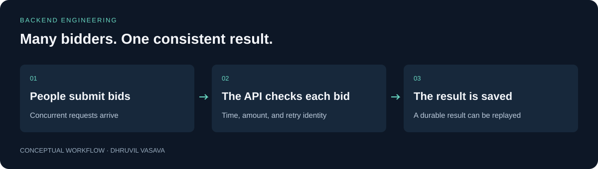

# Auction Bidding Engine

**Many bidders. One consistent result.**

An auction backend that keeps bids consistent when many people bid at once. It remembers the result of a request, so a retry after a lost connection does not accidentally create another bid.

Useful for understanding the reliability problems behind auctions, bookings, and other systems where concurrent requests compete for the same resource.



[Quick start](#try-it-locally) · [Technical guide](docs/TECHNICAL_GUIDE.md) · [Checks](https://github.com/Dhruvil151/auction-bidding-engine/actions) · [Portfolio](https://github.com/Dhruvil151)

## A simple example

An auction is at ₹100. Two people offer ₹120 and ₹150. The engine orders the decisions and keeps one current top bid. If the ₹150 bidder loses their connection, retrying the same request returns its saved result.

## What it does

- Rejects bids that are too low or outside the auction window.
- Replays repeated requests and detects conflicting reuse of a request key.
- Recovers decisions interrupted between database writes.
- Includes concurrency tests and recorded local load-test results.

## Try it locally

```sh
npm ci
docker compose up -d db
npm run db:init
npm run seed -- demo-auction
npm run dev
```

Requires Node.js 24 and Docker. The API runs on `http://localhost:3000`. The technical guide includes a complete example request and a Docker-only setup.

## How it is built

**TypeScript · Node.js · Fastify · RethinkDB · Vitest · Docker**

The current top bid and pending decision share one database document so the critical update can be atomic. A separate request ledger preserves history without growing the hot auction document indefinitely.

See the [technical guide](docs/TECHNICAL_GUIDE.md) for setup details, architecture, and implementation boundaries.

## Engineering decisions

### Keep the winning decision atomic

The current top bid and pending decision live in one auction document; a conditional update checks the version before changing the winner. This keeps competing bids consistent without relying on a lock in one API process. One hot auction still serializes decisions.

### Remember requests separately

A request ledger stores outcomes keyed by auction and idempotency key. Retries can replay a saved result while the hot auction document stays bounded. Retention needs an explicit policy before production.

### Recover interrupted writes

Save a pending decision before completing the request ledger; retries or the recovery command finish it. The design handles the gap between two document writes without pretending they are a database transaction.

## Checks and evidence

```sh
npm run typecheck
npm run test:unit
npm run build
```

For database-backed tests, start RethinkDB and run `npm test`. See [load results and methodology](docs/LOAD_RESULTS.md); short local bursts are not production capacity guarantees.

The [publication validation report](VALIDATION.md) records earlier checks and their limits. GitHub Actions records checks for subsequent commits.

## Current scope

Backend exercise with local tests and benchmarks. Authentication, payments, winner settlement, replicated failover, and public deployment are outside its current scope.


## License

Original project code and documentation are available under the [MIT License](LICENSE). Third-party dependencies and assets retain their own licenses; see [third-party notices](THIRD_PARTY_NOTICES.md).
